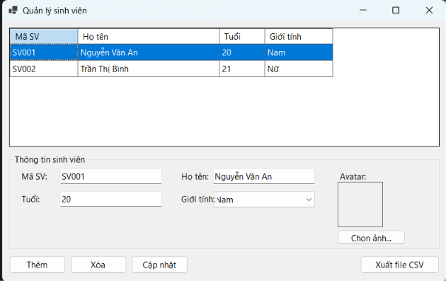
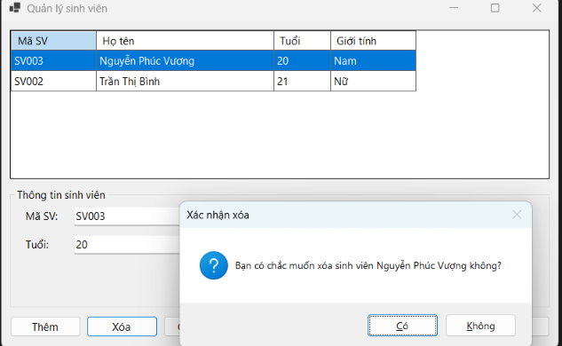
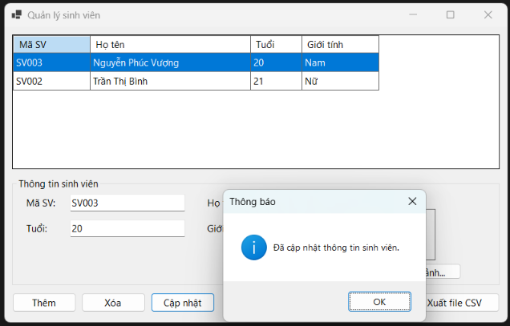
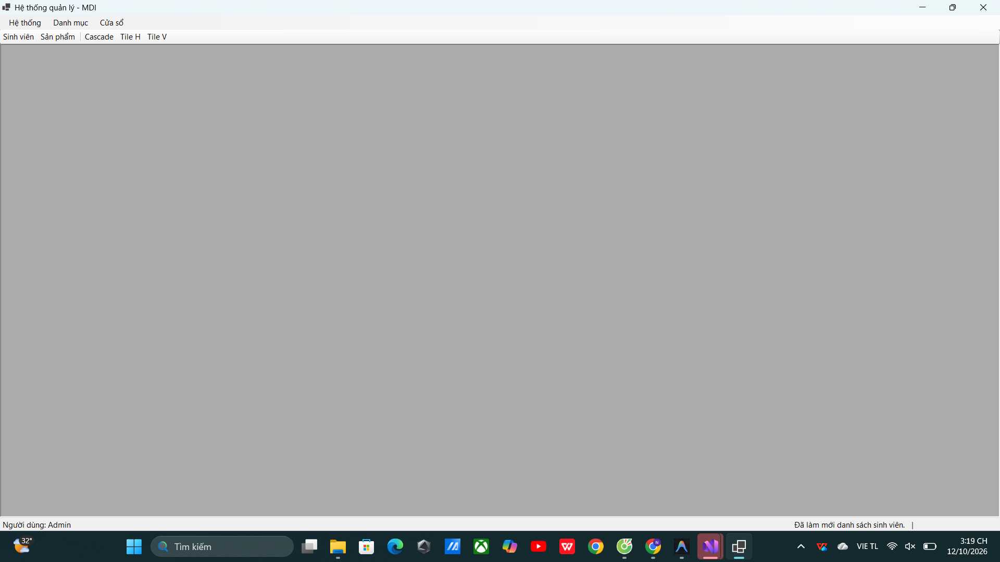
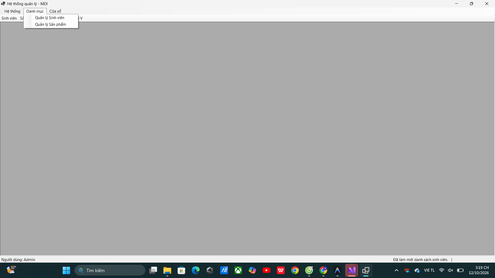
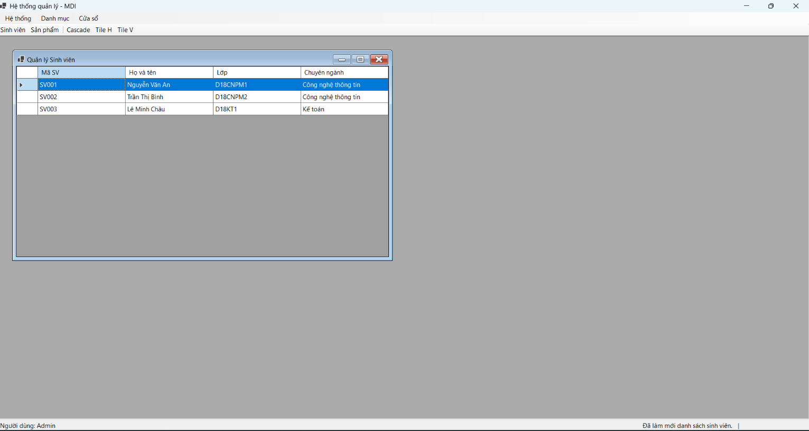
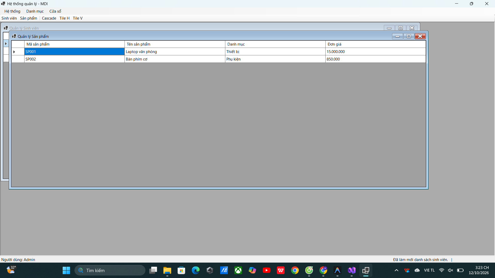
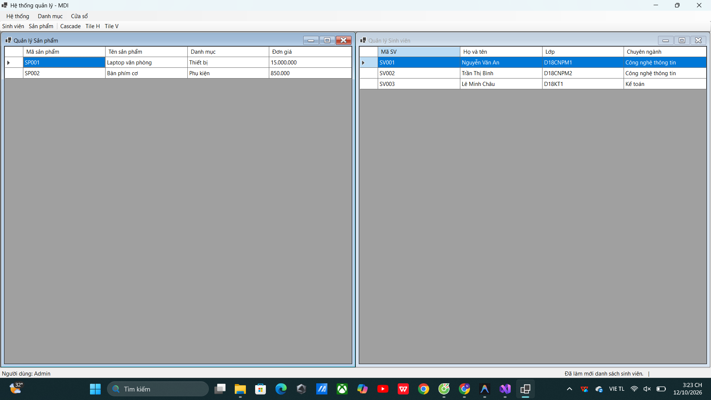
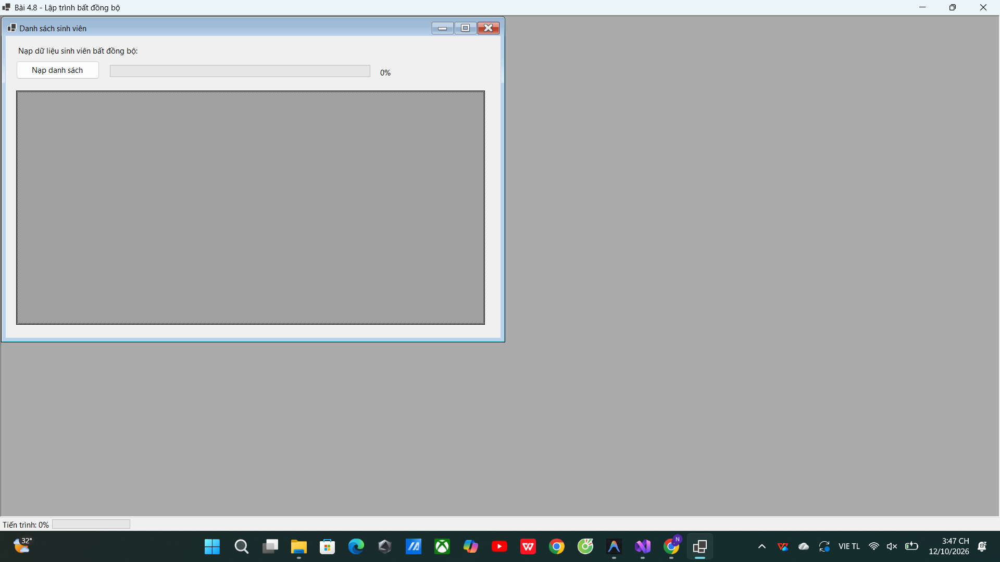
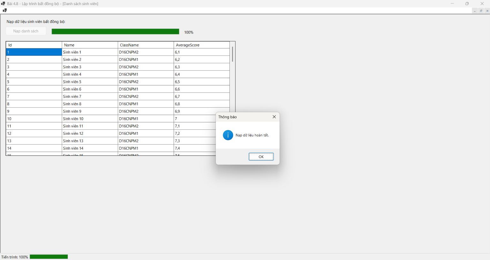

# BÁO CÁO BÀI TẬP / ĐỒ ÁN

## THÔNG TIN SINH VIÊN
- **Họ và tên:** Nguyễn Phúc Vượng
- **Mã số sinh viên:** 24810320187
- **Lớp:** D19QTANM1
- **Tên môn học:** Lập trình C# / Windows Forms
- **Tên bài tập:** Bài tập ngày 12/10 – Bài 4.6, Bài 4.7, Bài 4.8

---

## NỘI DUNG VÀ KẾT QUẢ THỰC HÀNH

### PHẦN 1. BÀI 4.6 – QUẢN LÝ SINH VIÊN (DATAGRIDVIEW, CRUD & XUẤT CSV)

#### 1. Giao diện chính Quản lý sinh viên

#### 2. Thêm mới sinh viên

#### 3. Xác nhận xóa sinh viên

#### 4. Cập nhật thông tin sinh viên thành công

#### 5. Xuất danh sách sinh viên ra file CSV

---

### PHẦN 2. BÀI 4.7 – HỆ THỐNG QUẢN LÝ MDI (MENUSTRIP, TOOLSTRIP, CONTEXTMENU)

#### 1. Giao diện Form cha MDI

#### 2. Menu Danh mục quản lý

#### 3. Menu Cửa sổ (Điều hướng & Sắp xếp form con)

#### 4. Mở Form con Quản lý Sinh viên

#### 5. Mở đồng thời Form con Quản lý Sản phẩm

#### 6. Sắp xếp cửa sổ theo chiều ngang (Tile Horizontal)

#### 7. Sắp xếp cửa sổ theo chiều dọc (Tile Vertical)

#### 8. Menu ngữ cảnh (ContextMenuStrip) trên DataGridView

---

### PHẦN 3. BÀI 4.8 – LẬP TRÌNH BẤT ĐỒNG BỘ (ASYNC / AWAIT & PROGRESS BAR)

#### 1. Giao diện ban đầu trước khi nạp dữ liệu

#### 2. Nạp dữ liệu bất đồng bộ và báo cáo tiến trình hoàn tất 100%

